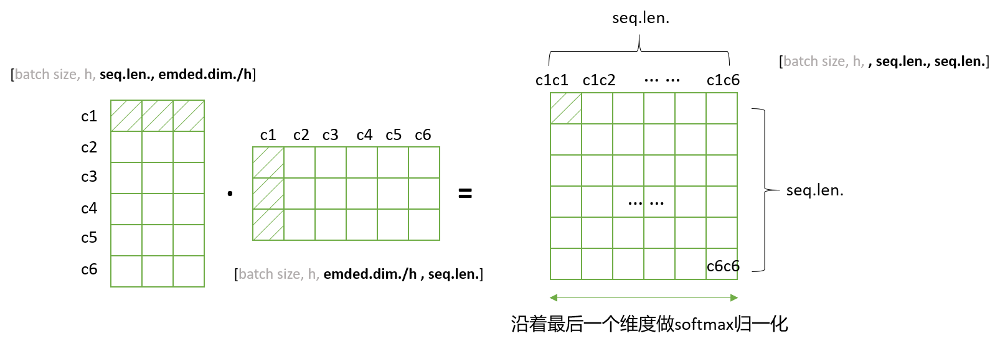

## 大模型相关

[大模型微调](../LLM/fine_tuning.md)

[RLHF](../RL/RLHF.md)


<details>
<summary>DPO (Direct Preference Optimization, 直接偏好优化)</summary>

<br>

**背景回顾**

> 传统 RLHF 三步骤：
> - SFT（Supervised Fine-Tuning）：用高质量数据监督微调基础模型。
> - RM（Reward Model）训练：基于人类选择 A 优于 B 的对比数据训练奖励模型。
> - PPO 强化学习：用奖励模型优化语言模型，强化“人类喜欢的输出”。
> 
> 存在问题：
> - RM + PPO 很复杂，训练难调
> - PPO 不稳定，样本效率低
> - 架构复杂，训练耗时

**DPO 的工作流程**

> **核心思想**：绕过奖励模型，直接优化原模型使其符合人类偏好
> 
> 它是RLHF的一种替代方案，但不需要强化学习，不用什么奖励模型，**只用监督学习方式**就能搞定。
> 
> **第一步：准备数据（成对偏好数据）**
> 
> - Prompt: “介绍一下猫和狗的区别。”
> - 回答 A（chosen）：猫和狗都是常见的宠物，猫通常独立，狗更黏人。
> - 回答 B（rejected）：狗是动物，猫不是狗。
> - 很明显，人更喜欢回答 A
> 
> 那么就记录一个三元组：`[prompt, chosen_response=A, rejected_response=B]`
> 
> **第二步：准备两个模型**
> 
> - 当前模型 $\pi$（要训练的模型）
> - 参考模型 $\pi_{ref}$（固定的，不训练，用来当参照物）
> 
> **第三步：给两个回答打分（模型算概率）**
> 
> 得到了 4 个数字：
> 
> ```bash
> log π(chosen | prompt)
> log π(rejected | prompt)
> log π_ref(chosen | prompt)
> log π_ref(rejected | prompt)
> ```
> 
> **第四步：计算“谁更好”的损失函数**
> 
> $$
> L=-\log \sigma (\beta · [\log \pi (y^+) - \log \pi (y^-) - (\log \pi_{ref} (y^+) - \log \pi_{ref} (y^-))])
> $$

**DPO 损失函数详解**

> **第一步：比较两个答案的概率差**
> 
> 用 log-prob（对数概率）来表示模型对两个回答的倾向：
> 
> $$
> \Delta_{\pi}=\log \pi (y^+) - \log \pi (y^-)
> $$
> 
> 如果这个值越大，说明模型越偏向好回答。
> 
> **第二步：减去参考模型的偏好差**
> 
> 如果我们有一个参考模型（比如 SFT 模型 $\pi_{ref}$），我们可以只优化“比参考模型更好的那部分”：
> 
> $$
> \Delta_{diff}=\Delta_{\pi} - \Delta_{\pi_{ref}}
> $$
> 
> **第三步：放进 sigmoid + log 中变成分类损失**
> 
> $$
> L=-\log \sigma (\beta · (\Delta_{\pi} - \Delta_{\pi_{ref}}))
> $$
> 
> 其中：
> - $\sigma(z) = \frac{1}{1 + e^{-z}}$是 sigmoid 函数；
> - $\beta$ 是一个温度参数，控制 sharpness（一般取 1.0）。
> 
> 所以最后就是：
> 
> $$
> L=-\log \sigma (\beta · [\log \pi (y^+) - \log \pi (y^-) - (\log \pi_{ref} (y^+) - \log \pi_{ref} (y^-))])
> $$
> 
> 也可以用softmax的形式表示：
> 
> $$
> L=-\log (\frac{e^{\beta (\log \pi (y^+) - \log \pi_{ref} (y^+))}}{e^{\beta (\log \pi (y^+) - \log \pi_{ref} (y^+))} + e^{\beta (\log \pi (y^-) - \log \pi_{ref} (y^-))}})
> $$

**DPO 相对于 RLHF 的优点总结**

> 1. 无需奖励模型（Reward Model）
>    1. RLHF：需要先训练一个奖励模型（Reward Model, RM）来估计人类偏好，然后再通过 PPO 等算法微调策略模型。
>    2. DPO：直接使用人类偏好数据进行优化，不需要显式训练奖励模型，省去一个步骤，减少误差传播。
> 2. 更稳定、更简单的训练过程
>    1. RLHF（如 PPO）：是基于强化学习的复杂优化过程，需要价值函数估计、advantage 计算、clip 等技巧，训练过程不稳定，调参困难。
>    2. DPO：是一个纯监督学习形式（logistic loss），没有 RL 的不稳定性，更容易训练和复现。
> 3. 无策略偏移（Policy Misalignment）问题
>    1. PPO 优化的是 reward，而不是人类真实偏好，有可能导致策略漂移。
>    2. DPO 明确建模偏好概率分布，优化的目标是让模型产生更偏好的人类答案，目标更贴近实际偏好数据。
> 4. 更强的可解释性
>    1. DPO 的 loss 是一个有明确意义的对数偏好概率（log-sigmoid），结果更易解释；
>    2. RLHF 的 reward 是间接学习到的，缺乏可解释性。

</details>


<details>
<summary>TRPO (Trust Region Policy Optimization, 信赖域策略优化)</summary>
<br>

**背景：为什么要 TRPO？**

> 在传统的策略梯度方法（如 REINFORCE、Vanilla Policy Gradient）中，策略更新步长过大时，容易导致策略发生剧烈变化，训练过程不稳定，甚至性能退化。
>
> - 问题1：策略更新“跳太远”
>   - 策略是概率分布，参数稍微变化就可能导致行为完全不同。
>   - 大步长更新可能让策略“崩掉”。
> - 问题2：目标函数无约束
>   - 传统方法直接最大化期望回报，没有限制策略变化幅度。
> - 问题3：训练不稳定
>   - 策略更新过大，导致采样分布和目标分布差异过大，梯度估计不准确，训练容易发散。

**TRPO 的核心思想**

> TRPO 的核心思想：每次更新策略时，限制新旧策略之间的“距离”不超过一个信赖域（trust region），保证策略变化平稳，训练更稳定。
>
> - 用 KL 散度（Kullback-Leibler Divergence）度量新旧策略的差异。
> - 通过约束 KL 散度，确保每次策略更新不会“跳太远”。
> - 本质上是“在保证安全的范围内，尽可能提升策略性能”。

**TRPO 的算法流程**

> 1. 采样：用当前策略$\pi_{old}$与环境交互，收集一批轨迹（state, action, reward）。
> 2. 估计优势函数：用 GAE（Generalized Advantage Estimation）等方法估算每个动作的优势$A_t$。
> 3. 构建目标函数：最大化新旧策略概率比加权的优势期望。
> 4. 信赖域约束：约束新旧策略的平均 KL 散度不超过$\delta$（如 0.01）。
> 5. 求解优化问题：用二阶优化（如共轭梯度法）近似求解带约束的最大化问题，得到新的策略参数。
> 6. 更新策略：用新参数替换旧策略，进入下一轮。

**TRPO 的目标函数**

> TRPO 的优化目标是：
>
> $$
> \max_{\theta} \ \mathbb{E}{s,a \sim \pi{\text{old}}} \left[ \frac{\pi_{\theta}(a|s)}{\pi_{\text{old}}(a|s)} A^{\pi_{\text{old}}}(s,a) \right]
> $$
>
> 同时约束新旧策略的平均 KL 散度不超过阈值$\delta$：
>
> $$
> \text{subject to} \ \mathbb{E}{s \sim \pi{\text{old}}} \left[ D_{KL}(\pi_{\text{old}}(\cdot|s) \| \pi_{\theta}(\cdot|s)) \right] \leq \delta
> $$
>
> - 其中 $A^{\pi_{\text{old}}}(s,a)$ 是优势函数。
> - $D_{KL}$ 是 KL 散度，衡量新旧策略的“距离”。
> - δ 是一个超参数，控制每次更新的最大幅度。

**TRPO 的优缺点总结**

> | 优点 | 说明 |
> |------------------------------|--------------------------------------------------------------|
> | 更新稳定 | 通过 KL 散度约束，防止策略剧烈变化，训练过程更平滑 |
> | 理论收敛性好 | 有严格的理论保证，更新不会导致性能下降 |
> | 支持大步长 | 可以安全地使用较大的步长，提升优化效率 |
> | 适合高维、复杂策略 | 在大规模神经网络策略中表现良好 |
>
> | 缺点 | 说明 |
> |------------------------------|--------------------------------------------------------------|
> | 实现复杂，计算量大 | 需要二阶优化（如共轭梯度法、Hessian 向量积），实现较复杂 |
> | 计算资源消耗高 | 每次更新涉及大量矩阵运算，训练速度慢于 PPO |
> | 不易扩展到大规模分布式场景 | 二阶优化和全局 KL 约束难以高效并行化 |
> | 实践中常被 PPO 替代 | PPO 用剪切近似代替 KL 约束，效果相近但实现更简单，效率更高 |

**TRPO 与 PPO 的对比**

> - TRPO：严格的 KL 散度约束，二阶优化，理论保证强，计算复杂。
> - PPO：PPO中的 KL 散度只是加在损失函数后的类似于“正则项”的操作，并不是严格约束，而是“软KL惩罚”！

其中KL散度相关的部分可以查看[概率论部分](../basic/probability_theory.md#kl散度kullback-leibler-divergence)

</details>


<details>

<summary>GRPO (Group Relative Policy Optimization)</summary>

<br>

**从PPO到GRPO**

> PPO通过引入**裁剪（Clipping）**和**KL散度约束**来限制策略更新的幅度，从而在保证训练稳定性的同时，尽可能大地利用样本。
> 
> PPO的核心思想是：在每次迭代中，新策略与旧策略之间的差异不能太大，以避免策略的剧烈波动导致训练不稳定。
> 
> PPO的成功在于其在稳定性、样本效率和实现复杂度之间取得了良好的平衡，使其成为目前应用最广泛的强化学习算法之一。
> 
> 然而，PPO以及其他许多策略梯度算法，通常依赖于一个**价值网络**（Value Network）来估计状态的价值（或优势函数）。**价值网络的作用是为策略网络的更新提供一个基准，帮助策略网络判断当前动作的好坏**。虽然价值网络在一定程度上降低了策略梯度的方差，但它也带来了新的问题：
> 
> 1.  **计算开销和内存占用：** 价值网络本身是一个神经网络，其训练需要额外的计算资源和内存。在大规模模型（如大型语言模型）的训练中，这会成为一个显著的瓶颈。
> 2.  **价值估计的准确性：** 价值网络的训练也可能不稳定，其估计的准确性直接影响策略更新的质量。如果价值估计不准确，可能会导致策略更新的方向错误，甚至使训练过程发散。
> 3.  **超参数调优：** 价值网络的训练引入了额外的超参数，增加了算法的复杂性和调优难度。
> 
> 这些挑战促使研究者们探索新的策略优化方法，旨在在保持训练稳定性的同时，减少对价值网络的依赖，提高计算效率和样本效率。正是在这样的背景下，**组相对策略优化**（Group Relative Policy Optimization, GRPO）应运而生。

**GRPO核心思想与流程**

> GRPO的核心思想是：**通过在“组”内比较不同动作的相对奖励，直接估计优势函数，从而完全摒弃对价值网络的依赖。**
> 
> 这种方法更加直接和高效，尤其适用于那些生成式任务，例如大型语言模型（LLMs）的微调，因为LLMs通常会生成多个候选序列。
> 
> GRPO的算法流程可以概括为以下几个步骤：
> 
> 1. **数据收集（Rollout）：** 使用当前策略（旧策略）在环境中进行采样，收集一系列轨迹（状态-动作-奖励序列）。
> 2. **组内采样与生成：** 对于每个状态，不只生成一个动作，而是生成一组（K个）候选动作序列。
> 3. **奖励计算与归一化：** 对这K个候选动作序列分别计算其累积奖励。然后，对这些奖励进行归一化处理，得到相对优势。
> 4. **策略更新：** 利用计算出的相对优势，结合KL散度约束，更新策略网络。

**GRPO核心技术：分组相对优势**

> GRPO的数据结构与传统强化学习有所不同。它不再是简单的`(state, action, reward)`三元组，而是针对每个状态，拥有一组`(动作序列_i, 奖励_i)`的对。（下面用LLM来举例）
> 
> **1. 分组机制（Grouping）**
> 
> 对同一提示（prompt）生成K个响应构成一个组：
> 
> $$
> G=((y_1,r_1),(y_2,r_2),...,(y_K,r_K))
> $$
> 
> 其中，$r_i=R(y_i|x)$为响应$y_i$的奖励值
> 
> **2. 相对优势计算**
> 
> 组内标准化优势函数：
> 
> $$
> A_i=\frac{r_i-\mu_G}{\sigma_G+\varepsilon}
> $$
> 
> 其中：
> - $\mu_G=\frac{1}{K}\sum_{j=1}^K r_j$为组内平均奖励
> - $\sigma_G=\sqrt{\frac{1}{K}\sum_{j=1}^K (r_j-\mu_G)^2}$为组内标准差
> - $\varepsilon$是实现中防止除零的小常数，与后面的裁剪参数不同
>
> 在只使用最终结果奖励的常见设置中，同一回答的各个 token 使用相同的 $A_i$。标准 GRPO 不包含“标准化优势与排名优势加权混合”，也没有固定的“$\lambda=0.7$ 最佳”这一结论。[参考：DeepSeekMath 的 GRPO 定义](https://arxiv.org/abs/2402.03300)

**GRPO目标函数设计**

> GRPO的损失函数与PPO类似，也包含一个**策略比率（Policy Ratio）**和**KL散度约束**。
> 
> 策略比率 $r_t(\theta) = \frac{\pi_{\theta}(a_t|s_t)}{\pi_{\theta_{old}}(a_t|s_t)}$。
> 
> 单个 token 的核心优化项可以表示为（最大化这个目标，训练时通常取负作为 loss）：
> 
> $J_t(\theta) = \min(r_t(\theta) A_t, \text{clip}(r_t(\theta), 1-\epsilon, 1+\epsilon) A_t) - \beta D_{\mathrm{KL}}(\pi_{\theta}(\cdot|s_t)\|\pi_{\mathrm{ref}}(\cdot|s_t))$
>
> 原始 GRPO 先按每条回答的 token 数平均，再在组内回答之间平均；上式只展示核心项，KL 在实现中通常使用采样估计。
> 
> 其中：
> - $A_t$ 是通过组内采样计算得到的优势函数。
> - $\epsilon$ 是裁剪参数，用于限制策略更新的幅度。
> - $\beta$ 是 KL 项权重，用于控制当前策略与参考策略 $\pi_{\mathrm{ref}}$ 的偏离。
> - $\pi_{\theta_{old}}$ 是采集本批回答的旧策略，用于概率比率；$\pi_{\mathrm{ref}}$ 是 KL 约束的参考策略，两者职责不同。
> 
> 这个损失函数的目标是最大化相对优势，同时通过裁剪和KL散度约束来确保策略更新的稳定性。

**GRPO创新点与解决的问题**

> 1.  **摒弃价值网络：**
>     *   **创新点：** 这是GRPO最显著的创新。它不再需要训练一个独立的价值网络来估计状态价值或优势函数。
>     *   **解决的问题：**
>         *   **计算效率：** 大幅减少了训练所需的计算资源和内存占用，使得GRPO在大规模模型训练中更具可行性。
>         *   **训练稳定性：** 消除了价值网络训练可能带来的不稳定性和误差传播，简化了算法的整体训练流程。
>         *   **超参数简化：** 减少了需要调优的超参数数量，降低了算法的复杂性。
> 
> 2.  **组内相对优势估计：**
>     *   **创新点：** 通过在同一状态下采样多个动作序列，并计算它们之间的相对奖励来直接估计优势。
>     *   **解决的问题：**
>         *   **优势估计的直接性：** 避免了通过复杂的函数逼近来估计优势，使得优势估计更加直接和鲁棒。
>         *   **样本效率：** 在一定程度上提高了样本效率，因为每次策略更新都利用了同一状态下的多个样本信息。
> 
> 3.  **适用于生成式任务：**
>     *   **创新点：** GRPO的“组”概念与生成式任务（如文本生成）中模型可以生成多个候选输出的特性天然契合。
>     *   **解决的问题：**
>         *   **LLMs微调：** 为大型语言模型（LLMs）的强化学习微调提供了一种高效且稳定的方法。在LLMs中，模型可以生成多个响应，GRPO可以利用这些响应的相对质量来指导模型学习。
> 
> 4.  **KL散度约束的保留：**
>     *   **创新点：** 虽然摒弃了价值网络，但GRPO依然保留了PPO中有效的KL散度约束。
>     *   **解决的问题：**
>         *   **策略稳定性：** 确保了策略更新的幅度得到有效控制，防止策略发生剧烈变化，从而保持训练的稳定性。
>         *   **收敛性：** 有助于算法的收敛，避免策略在训练过程中发散。

**GRPO的优势总结**

> *   **高效性：** 无需价值网络，显著降低计算和内存开销。
> *   **稳定性：** 通过组内相对优势和KL散度约束，确保策略更新的稳定。
> *   **样本效率：** 利用组内采样，更有效地利用数据。
> *   **适用性广：** 特别适用于生成式任务，如大型语言模型的微调。

</details>


<details>
<summary>大模型幻觉</summary>

<br>

**大模型幻觉的定义**

> 大模型生成的内容在语法上合理、语言上流畅，但在事实层面是错误的、不存在的、虚构的。
> 比如：
> 
> - 编造一个不存在的学术引用或论文标题；
> - 虚构一个 API 函数或参数；
> - 错误地归因某个概念；
> - 给出不存在的历史事件。
> 
> 这些看似“有根有据”的内容，其实完全是语言生成模型自我联想出来的产物。

**大模型产生幻觉的根本原因**

> 1. 预测下一个词，而非理解世界
>    1. 大语言模型的核心训练目标是：**最大化下一个词的预测概率，而不是最大化“事实正确性”**。
>    2. 这意味着：模型学到的是“给定上下文，什么词更可能出现”，不是“什么词真实存在”。
>    3. 所以它会倾向于生成“语言上合理”的内容，而不是“客观上正确”的内容。
> 2. 没有访问真实世界的机制
>    1. 语言模型在推理时**并不访问知识库或数据库**，它所有的**信息来自预训练语料内部的统计关系**。
>    2. 如果在训练数据中看到“爱因斯坦是物理学家”很多次，它会记住这个模式。
>    3. 但如果被问“爱因斯坦出生在哪个城市”，训练数据没有明确出现，它就会“推测”一个听起来合理的答案，比如“柏林”或“法兰克福”，即使是错误的。
> 3. 缺乏事实验证机制
>     1. 人类说话时会主动校验知识的真伪（或查询资料），而语言模型并不会“怀疑自己”，不知道“自己不知道”，也**没有机制去查证信息**。这就导致它有时“自信地胡说八道”。
> 4. 语言模型的泛化能力 ≠ 事实归纳能力
>    1. 语言模型具有很强的“模式泛化”能力。
>    2. 但它泛化的结果可能在形式上合理、在内容上却是编造的。
>    3. 这种幻觉本质上来自于它**在语言空间中“走捷径”模拟真实语境，但忽略了事实基础**。
> 5. 训练数据本身可能含有错误或矛盾
>    1. 模型的知识来源（如互联网语料）中可能包含伪科学、虚假信息、语义歧义、讽刺或误传。
>    2. 模型并不会区分“真假”，而是学习“出现频率高、上下文自然”的内容。
>    3. 这也会进一步导致幻觉。
> 
> | 根本原因     | 说明                                         |
> | ------------ | -------------------------------------------- |
> | 目标错位     | 模型训练目标是“语言流畅性”，不是“事实正确性” |
> | 缺乏世界模型 | 模型没有知识图谱或物理世界的真实建模         |
> | 无检索能力   | 推理时不能动态查询真实信息，靠“记忆”瞎猜     |
> | 不具备“意识” | 不知道自己何时知道或不知道（缺乏元认知能力） |
> | 数据噪声     | 训练数据本身就可能包含错误和模糊信息         |

**如何缓解幻觉**

> 虽然幻觉无法彻底消除，但以下技术可以显著缓解：
> 
> - RAG（检索增强生成）：先查资料再回答
> - 指令微调（SFT）：用高质量、指令数据微调模型
> - 知识注入（KNN-LM、LoRA + 专业知识）
> - 校验模块：在后处理时进行事实校验与剔除
> - 限制生成范围：如有限选项、多轮对话确认
> - 训练阶段优化：使用 RLHF（人类反馈强化学习）减少幻觉


</details>

<details>
<summary>transformer 中为什么使用 layer normalization 而不是用 batch normalization</summary>

<br>

> 1. 对批次大小的敏感性​​
>    1. ​批归一化（BN）​​：依赖于当前批次的统计量（均值和方差），​**在​小批次或批次大小变化时​​表现不稳定**。例如，在自然语言处理（NLP）任务中，由于**句子长度不同**，常需动态填充（padding）或截断，导致批次内有效样本数不一致，影响BN的统计量计算。
>    2. ​层归一化（LN）​​：对​**​单个样本的所有特征维度​​计算统计量**，与批次无关。无论批次大小如何，LN始终能稳定归一化，更适合Transformer中变长序列和动态批次的场景。
>    3. 大模型训练时，多机多卡情况下，BN还有通信消耗。
> 2. Transformer处理的是​**​​序列数据​**​​（如文本中的单词），其自注意力机制使得​**每个位置的输出依赖于所有其他位置​**。此时：
>    1. ​BN的缺陷​​：若对整个批次的不同位置计算统计量，​**不同样本间的依赖关系可能引入噪声，破坏局部模式​**。
>    2. ​LN的优势​​：对同一序列内的所有位置独立归一化，​**保留序列内部的一致性​**，避免跨样本的信息干扰。
> 3. 训练与推理的一致性​​
>    1. ​​​BN在推理阶段​需要维护全局的移动平均统计量，而​​**​训练阶段的批次统计量可能与推理阶段分布不同​**​​（尤其在小批次或在线学习时），导致不一致。
>    2. ​LN无此问题​​：归一化仅依赖当前样本的特征，训练与推理行为完全一致，简化了部署流程。
> 4. 位置编码的兼容性​​
>    1. Transformer依赖位置编码（Positional Encoding）注入序列顺序信息。若使用BN，不同位置的统计量可能被混合，削弱位置信息的作用；而​**​LN仅在单个序列内操作，保留了位置编码的独立性​**​。
> 
> | 特性                | 层归一化（LN）                       | 批归一化（BN）                  |
> | ------------------- | ------------------------------------ | ------------------------------- |
> | ​统计量计算范围​​   | 单个样本的所有特征                   | 当前批次的所有样本的同一特征    |
> | ​依赖批次大小​​     | 否                                   | 是                              |
> | ​处理变长序列​​     | 更稳定                               | 需填充/掩码，可能引入噪声       |
> | ​训练与推理一致性​​ | 完全一致                             | 需维护移动平均，可能不一致      |
> | ​适用场景​​         | 序列模型（Transformer、RNN）、小批次 | 图像模型（CNN）、大批次稳定场景 |

</details>

<details>
<summary>multi-head self-attention（及transformer代码）</summary>

<br>

**self-attention**

Q：查询矩阵（理解：搜索栏中输入的查询内容）

$$
Q=XW^Q
$$

K：键矩阵（理解：数据库中与Q相关的一组关键字）

$$
K=XW^K
$$

V：值矩阵（理解：系统通过计算，展示最匹配K的所对应的内容V）

$$
V=XW^V
$$

总的公式：

$$
Attention(Q,K,V)=softmax(\frac {QK^T}{\sqrt{d_k}})V
$$

Attention 就是将想要查询的 Q 与数据库中的 K 进行比较，一对一地测量它们之间的相似度，并最终从最高相似度顺序向下依次并排列索引到的 V。所以，也可以理解 Attention 为一个数据库查表的过程。


拿出一组多头自注意力来解释流程：



1. 先计算 Q 与 K 的转置的点积。
2. 点积的结果就是生成注意力矩阵（**上图**）。
3. 然后用SoftMax进行归一化，这样每个字跟其他所有字的注意力权重的和为1。注意力矩阵的第一行就是第一个字c1与这六个字分别的相关程度（**这个理解很关键**）。
4. 接着用注意力矩阵给V加权，就可以找到最相关的值。

**multi-head**

> 多头注意力机制就是对同一个输入，使用**不同的** Q、K、V 权重**进行多组注意力计算**，得到多个结果后拼接起来，再通过**线性变换融合为最终输出**。

举个例子：

```bash
# 假设有一句话：I LOVE AI。
# 在输入 Transformer 之前，首先每个词（token）会被嵌入（embedding）成一个向量，比如（可见上图）：
# "I" → [0.2, -1.1, ..., 0.5]
# "love" → [1.3, 0.8, ..., -0.4]
# "AI" → [0.7, -0.9, ..., 1.2]
# 这个向量的长度就是 d_model，比如 512，那就是每个词用一个 512维的向量表示。就类似于CV中卷积完的“通道”维度。
# 假如 head 的个数为 8，那么就是每个头处理 64 个“通道”。
```


| 问题                     | 答案                                                                                                                                                                  |
| ------------------------ | --------------------------------------------------------------------------------------------------------------------------------------------------------------------- |
| 多头注意力计算量是否更大 | 是，确实增加了计算量，因为有h组QKV计算而不是一组<br>每一组都要做一次完整的 attention 运算<br>最后还要做一次拼接与线性映射                                             |
| 为什么计算量“增加但没炸” | 虽然用了多个 attention head，但**每个 head 的维度更小**，从而控制住了总计算量。<br>没有重复计算整份，每个 head 只负责**分工处理**一个低维空间，而不是全维度重复处理。 |
| 多头比单头效果更好       | 是，能捕捉多种语义关系，提升表达能力                                                                                                                                  |
| 多头效率低，难以训练     | 否，框架优化良好，都会对 multi-head attention 做高效并行化处理                                                                                                        |

<br>

**softmax**：

$$
softmax=\frac{e^{z_i}}{\sum_{j=1}^{n}{e^{z_j}}}
$$

**code**

```python
import torch
import torch.nn as nn
import math

# 1. Scaled Dot-Product Attention
class ScaledDotProductAttention(nn.Module):
    def __init__(self):
        super().__init__()
    
    def forward(self, Q, K, V, mask=None):
        d_k = Q.size(-1)
        scores = Q @ K.transpose(-2, -1) / math.sqrt(d_k)
        if mask is not None:
            scores = scores.masked_fill(mask == 0, float('-inf'))
        attn = torch.softmax(scores, dim=-1)
        return attn @ V, attn

# 2. Multi-Head Attention
class MultiHeadAttention(nn.Module):
    def __init__(self, d_model, num_heads):
        super().__init__()
        assert d_model % num_heads == 0
        self.d_k = d_model // num_heads
        self.num_heads = num_heads

        self.W_q = nn.Linear(d_model, d_model)
        self.W_k = nn.Linear(d_model, d_model)
        self.W_v = nn.Linear(d_model, d_model)
        self.fc = nn.Linear(d_model, d_model)
        self.attn = ScaledDotProductAttention()

    def forward(self, x, mask=None):
        B, L, D = x.size()
        Q = self.W_q(x).view(B, L, self.num_heads, self.d_k).transpose(1, 2) # transpose之后：(batch_size, num_heads, length, d_k)
        K = self.W_k(x).view(B, L, self.num_heads, self.d_k).transpose(1, 2) # 同上
        V = self.W_v(x).view(B, L, self.num_heads, self.d_k).transpose(1, 2) # 同上

        out, attn = self.attn(Q, K, V, mask)
        out = out.transpose(1, 2).contiguous().view(B, L, D)
        return self.fc(out)

# 3. Position-wise Feedforward
class FeedForward(nn.Module):
    def __init__(self, d_model, d_ff):
        super().__init__()
        self.linear1 = nn.Linear(d_model, d_ff)
        self.linear2 = nn.Linear(d_ff, d_model)

    def forward(self, x):
        return self.linear2(torch.relu(self.linear1(x)))

# 4. Positional Encoding
class PositionalEncoding(nn.Module):
    def __init__(self, d_model, max_len=5000):
        super().__init__()
        pe = torch.zeros(max_len, d_model)
        pos = torch.arange(0, max_len).unsqueeze(1).float()
        div_term = torch.exp(torch.arange(0, d_model, 2).float() * (-math.log(10000.0) / d_model))
        pe[:, 0::2] = torch.sin(pos * div_term)
        pe[:, 1::2] = torch.cos(pos * div_term)
        self.pe = pe.unsqueeze(0)  # shape: (1, max_len, d_model)

    def forward(self, x):
        return x + self.pe[:, :x.size(1)].to(x.device)

# 5. Transformer Encoder Layer
class TransformerEncoderLayer(nn.Module):
    def __init__(self, d_model, num_heads, d_ff, dropout=0.1):
        super().__init__()
        self.attn = MultiHeadAttention(d_model, num_heads)
        self.ffn = FeedForward(d_model, d_ff)
        self.norm1 = nn.LayerNorm(d_model)
        self.norm2 = nn.LayerNorm(d_model)
        self.dropout = nn.Dropout(dropout)

    def forward(self, x, mask=None):
        x = self.norm1(x + self.dropout(self.attn(x, mask)))
        x = self.norm2(x + self.dropout(self.ffn(x)))
        return x

# 6. Full Transformer Encoder
class TransformerEncoder(nn.Module):
    def __init__(self, vocab_size, d_model=512, num_heads=8, d_ff=2048, num_layers=6, max_len=512):
        super().__init__()
        self.embedding = nn.Embedding(vocab_size, d_model)
        self.pos_encoding = PositionalEncoding(d_model, max_len)
        self.layers = nn.ModuleList([
            TransformerEncoderLayer(d_model, num_heads, d_ff) for _ in range(num_layers)
        ])
        self.norm = nn.LayerNorm(d_model)

    def forward(self, src, mask=None):
        x = self.embedding(src) * math.sqrt(self.embedding.embedding_dim)
        x = self.pos_encoding(x)
        for layer in self.layers:
            x = layer(x, mask)
        return self.norm(x)
```

</details>


<details>
<summary>位置编码相关</summary>

<br>

**为什么transformer需要位置编码**

> - transformer本身不具备对序列中位置信息的天然捕捉能力，而位置信息对于理解和处理序列数据非常重要。
> - transformer在经过多头注意力之后，虽然保留了 token 顺序在输入排列中，但其核心注意力机制**完全不理解“第几个”**，它只看内容相关性（Query 和 Key 的匹配），所以**必须注入显式的位置信息**。

**为什么用正余弦函数做绝对位置编码**

> - 周期性 + 多频率，能表达多尺度的位置关系。使用不同频率的正余弦函数，能让模型同时看到：
>   - 粗粒度（低频）的位置变化（如 token 之间的长距离关系）
>   - 细粒度（高频）的位置变化（如短距离关系）
> - 可泛化到未见过的位置（外推能力）：
>   - 正余弦是连续且无限扩展的函数，不像词嵌入那样只能训练固定位置。
>   - 这使得模型能**泛化到比训练时更长的输入序列**（位置编码值是函数计算，不需要词表）
> - 内积保留相对位置信息：
>   - 两个位置编码的点积值随着相对距离变化是可预测的，方便模型感知相对位置。
> - 为什么不用别的函数：
>   - 正余弦函数具有良好的数学结构（傅里叶分析），能被神经网络有效学习、稳定训练。
>   - 用别的函数可能会导致：不可微、不平滑；不具备周期性和可推广性；不支持推理时生成新位置的编码

**为什么使用相对位置编码（绝对位置编码对长文本建模能力不足）**

> - 位置不再具有区分度：
>   - 在较长的文本中，远距离位置的正余弦编码值**趋于平滑或重叠**。
>   - 比如输入是 10000 长的序列，对于位置 500 和位置 502，它们编码差异很小。很多位置编码会“模糊在一起”，模型难以识别远距离结构。
> - 绝对位置编码只是告诉模型 token 处在第几位，并不告诉模型“我距离你多远”。在长文本中，这种**缺乏相对偏差的信息**，使得模型难以准确处理长距离依赖。
> - 不能跨上下文对齐（不支持滑动窗口）：
>   - 在长文本切分成段处理时，**绝对位置不具有平移不变性**，无法对齐 token 的上下文。

**ROPE 为什么能表示位置信息？旋转 QK 向量和“位置”有什么关系？**

> **ROPE 的核心思想**是：用二维向量的“旋转角度”来编码 token 所处的位置，并且这种角度变化能够影响 attention 的结果。
> 
> 怎么理解：
> 
> - 假设每个向量都是二维平面上的点，如 (x,y)
> - 给位置 1 的 token 转一个角度α，位置 2 的 token 转角度β。
> - 计算 QK 的点积时，这个旋转角度会影响它们的相关性（因为旋转后的向量方向不同）。
> 
> 数学一点：
> 
> 将 Q 和 K 的每一对维度当成一个二维向量，乘以一个旋转矩阵：
> 
> $$
> R(\theta)=
> \begin{bmatrix}
> cos\theta & -sin\theta \\
> sin\theta & cos\theta
> \end{bmatrix}
> $$
> 
> 这样，每个位置的向量就像顺时针旋转一定角度，而这个角度是基于其位置 `p` 和频率 `f` 设定的。
> 结果，注意力中的 Query 和 Key 相乘时，就带上了相对位置信息。
> 模型可以从这种“旋转差异”中学习相对距离，而不是像绝对编码那样只看“你在第几位”。

</details>

<details>
<summary>transformer在softmax中为什么要除以根号d_k</summary>

<br>

**注意力回顾**

> 在Transformer的自注意力（Self-Attention）机制中，计算注意力分数时有如下公式：
> 
> $$
> \text{Attention}(Q, K, V) = \text{softmax}\left(\frac{QK^T}{\sqrt{d_k}}\right)V
> $$
> 
> 其中，$Q$（Query）、$K$（Key）、$V$（Value）是通过输入和参数矩阵线性变换得到的，$d_k$是Key向量的维度。

**如果不除，会发生什么？**

> 设 $Q$ 和 $K$ 是随机初始化的，元素是独立的零均值高斯变量，维度为 $d_k$，则它们的点积 $Q \cdot K$ 的期望和方差如下：
> 期望：$E[Q \cdot K] = 0$
> 方差：$\text{Var}[Q \cdot K] = d_k$
> 也就是说：维度越高，点积值就越大（方差正比于 $d_k$）。
> 结果是：
> - 点积过大 -> softmax 输出变成 one-hot
> - 梯度传播变得不稳定（几乎只对一个位置有梯度）
> - 模型训练困难，学习缓慢甚至不收敛

**为什么除以 $\sqrt{d_k}$ 有用？**

> 这是为了把 $Q \cdot K^T$ 的值“标准化”到一个比较稳定的范围。
> 如果点积期望方差为 $d_k$，那么除以 $\sqrt{d_k}$ 后：
> - 方差变成 $\text{Var}[Q \cdot K] / d_k = 1$（随机变量 $X$ 除以常数 $c$，其 方差变化为：$\text{Var}(X / c) = \text{Var}(X) / c^2$）
> - 保证 softmax 输入值的尺度稳定在一个合理区间（比如 -4 到 +4）
> - softmax 输出更平滑，不至于极端化，利于训练

**举个极端例子（数值说明）**

> 假设没有除以 $\sqrt{d_k}$，某一对 $QK$ 点积值为 50，而其他值为 1：
> - $softmax([50, 1, 1, 1]) ≈ [~1, 0, 0, 0]$ -> 几乎 one-hot
> - 梯度集中在一个位置，模型变得不稳定
> 
> 而如果我们除以 $\sqrt{d_k}$（比如 $\sqrt{64} = 8$），点积值变成 6.25，softmax 输出就会更加平滑。

</details>


<details>
<summary>LoRA (Low-Rank Adaptation of Large Language Models)</summary>

<br>

在[大模型微调](../LLM/大模型微调.md)里面有详细介绍。

</details>

<details>
<summary>模型在训练和推理时的显存占用如何估算？</summary>

<br>

**显存消耗的组成部分**

> | 类型                                  | 说明                                                 | 是否训练阶段特有     |
> | ------------------------------------- | ---------------------------------------------------- | -------------------- |
> | 模型参数                              | 存储模型权重本身（如 Linear 层的权重矩阵）           | 否                   |
> | 参数梯度                              | 每个参数的梯度，训练时需要                           | ✅ 是                 |
> | 优化器状态                            | Adam 优化器需要记录每个参数的动量等状态              | ✅ 是                 |
> | 激活值（中间特征）                    | Transformer 每一层前向传播结果，训练时为反向传播保留 | ✅ 是（推理保留极少） |
> | 临时缓存（临时变量、LayerNorm缓存等） | 推理和训练都需要                                     | 否                   |
> | 显存碎片/其他系统开销                 | CUDA 系统、库分配的一些空间                          | 否                   |

**显存与模型参数量的关系**

> 以 `7B` 模型，参数精度 `fp16` 为例：
> 
> $$
> 显存 = 参数数量 \times 精度(bytes) = 7 \times 10^9 \times 2 bytes = 14 GB（模型权重）
> $$
> 
> **如果是训练，还需要加上**：
> 
> - 参数梯度（同样大小）：14 GB
> - Adam 优化器状态（通常是 2 × 参数大小）：28 GB（1 倍 动量m（momentum）内存，1 倍 动量v（RMS）内存）
> 
> **训练总共：~56 GB（不含激活）**

**显存与批次大小（Batch Size）的关系**

> 批次大小对显存的影响：
> 
> - 激活值（Activation）缓存增加：
>   - 每个输入样本在经过模型的每一层时都会产生中间结果（激活值），训练时这些> 激活值需要缓存，用于反向传播。
>   - 如果 batch size 是 1，就缓存 1 个样本的激活值；
>   - 如果 batch size 是 64，就缓存 64 个样本的激活值；
>   - 所以激活值缓存随 batch size **线性增长**。
> - 注意力矩阵缓存增加：
>   - 注意力权重矩阵的维度是 `[B,n_heads,seq_len,seq_len]`
>   - 所以显存中要存储的注意力矩阵量也会随着 batch size 增加而**线性增长**。
> 
> 因此显存占用大致与 batch size 成线性关系：
> 
> $$
> 显存 \propto BatchSize
> $$

**显存与序列长度（seq_len）的关系**

> 序列长度影响：
> 
> - 激活缓存量（如上所示）
> - 注意力矩阵大小：`[batch_size, n_heads, seq_len, seq_len]`
> 
> 因此注意力的显存增长为**平方级别**：
> 
> $$
> 显存 \propto {SeqLen}^2
> $$

</details>


<details>
<summary>Seq2Seq模型的核心组件是什么？Encoder-Decoder结构如何解决长程依赖问题？输入序列过长，如何解决计算量问题？</summary>

<br>

**Seq2Seq 模型的核心组件**

> Seq2Seq（Sequence-to-Sequence）是一类**将一个序列映射到另一个序列**的模型架构，广泛应用于：
> 
> - 机器翻译（如英文到法文）
> - 文本摘要
> - 问答系统
> - 语音识别等
> 
> 核心组件：
> 
> 1. Encoder：负责接收输入序列，并将其编码为一个向量（或一组向量）表示输入的语义信息
> 2. Decoder：接收 Encoder 的输出，并逐步生成目标序列（一个 token 一个 token 地预测）
> 3. Attention（可选）：提高模型对长序列的处理能力，允许 Decoder 在每一步关注输入序列的不同部分

**Encoder-Decoder 是如何解决长程依赖问题的？**

> 最初的 Seq2Seq 模型（无 Attention）的问题：
> 
> - Encoder 把整个输入序列**压缩成一个固定大小的向量**（称为上下文向量 context），再传给 Decoder。
> - 如果输入序列很长，固定向量无法承载全部信息 → **信息丢失，长程依赖难以建模**。
> 
> 引入 Attention 机制后的改进：
> 
> - Attention 机制让 Decoder 在生成每个词时动态地关注 Encoder 的输出中的不同位置。
> - 不再依赖一个固定向量，而是每个时间步都能参考整个输入序列。
> 
> 现代 Transformer 架构下的 Seq2Seq：
> 
> - 完全抛弃 RNN，用**自注意力（Self-Attention）+ 多头注意力**实现 Encoder 和 Decoder。
> - 每个位置可以直接访问序列中所有其他位置，**天然支持长程依赖**。
>
> **总结一句话**：Encoder-Decoder 架构通过引入 Attention 机制，让 Decoder 在生成序列时可以灵活关注输入序列的不同部分，从而有效解决长程依赖问题。

**如果输入序列很长，注意力矩阵的计算量和显存占用会迅速膨胀，如何解决计算量问题？**

> 注意力矩阵的维度是：`[batch_size,n_heads,seq_len,seq_len]`
> 计算复杂度：$O(SeqLen^2)$
> 
> 解决方法（**减少计算量/减少精度两种方式**）：
> 
> 1. **稀疏注意力**：复杂度从 $O(n^2)$ 降低到 $O(n \cdot \sqrt{n})$ 或 $O(n \cdot \log n)$
>    1. Longformer：局部窗口 + 全局 token 关注机制
>    2. BigBird：局部 + 稀疏跳跃 + 全局 token，理论上具备 Transformer 表达能力
>    3. Sparse Transformer：使用规则设计的稀疏注意力模式
>    4. Reformer：使用 LSH（局部敏感哈希）减少注意力计算
> 2. **线性注意力**：复杂度降为 $O(n)$，但可能会损失精度
>    1. Performer：利用核函数重写注意力为线性形式
>    2. Linformer：假设注意力矩阵是低秩的，对 K/V 做降维
>    3. Linear Transformer：修改注意力定义为线性形式
> 3. **分块输入（Chunking）或滑动窗口**：
>    1. 把长序列拆成多个短块，分别计算注意力，再用跨块机制（如 sliding window）进行上下文传播。
> 4. **使用低精度**：
>    1. 虽然不减少计算复杂度，但可以降低显存占用，让长序列训练更现实。

</details>


<details>
<summary>MoE（专家混合模型，Mixture of Experts）</summary>

**基本原理与优势**

> MoE（专家混合模型，Mixture of Experts）是一种深度学习模型结构，旨在通过引入多个“专家”子网络和一个“门控”机制，实现模型参数的高效利用和推理加速。MoE在大规模模型（如NLP中的大语言模型）中尤为流行，因为它能在不显著增加推理成本的情况下提升模型容量。
> 
> **基本原理**
> 
> - **专家（Experts）**：每个专家通常是一个独立的神经网络（如MLP），专注于处理输入空间的某一部分。
> - **门控网络（Gate）**：门控网络根据输入内容，动态选择最合适的一个或几个专家进行激活和计算，**其余专家不参与本次前向传播**。
> - **稀疏激活**：每次只激活少量专家（如Top-1或Top-2），大大减少了实际计算量。
> 
> **主要优势**
> 
> 1. **参数高效扩展**：可以在不增加推理计算量的前提下，极大地增加模型参数量（如Switch Transformer、GLaM等）。
> 2. **推理加速**：由于每次只激活部分专家，推理速度远快于同等参数量的全连接大模型。
> 3. **模型多样性**：不同专家可以学习输入空间的不同特征，提高模型泛化能力。
> 
> **典型结构**
> 
> 以Transformer中的MoE层为例，通常在Feed Forward部分插入MoE结构：
> 
> 1. 输入经过门控网络，计算每个专家的权重（通常用softmax）。
> 2. 选择Top-k个专家（如Top-1或Top-2），只将输入分配给这几个专家。
> 3. 专家输出加权求和，作为MoE层的输出。


**MoE常见问题及解决方案**

> **1. 专家负载不均衡（Load Imbalance）**
> 
> **问题描述**：门控网络可能会偏向某些专家，导致部分专家过载，部分专家几乎不被激活，影响训练效率和模型效果。
> 
> **解决方法**：
> - **负载均衡损失（Load Balancing Loss）**：在总损失中加入负载均衡项，鼓励门控网络均匀分配输入到各个专家。
> - **噪声门控（Noisy Gating）**：在门控分数中加入噪声，增加探索性，防止陷入局部最优。
> - **专家容量限制（Capacity Constraint）**：限制每个专家每次最多接收多少输入，超出部分丢弃或分配到其他专家。
> 
> **2. 通信和并行效率问题**
> 
> **问题描述**：大规模MoE模型通常需要跨多卡/多机分布式训练，专家之间的数据交换和同步会带来通信瓶颈。
> 
> **解决方法**：
> - **专家并行（Expert Parallelism）**：将不同专家分布到不同设备上，利用分布式框架（如DeepSpeed、FairScale）优化通信。
> - **局部专家分组（Local Expert Grouping）**：将专家分组，每组只在本地设备内通信，减少全局通信量。
> - **稀疏调度优化**：只传递被激活的专家数据，减少无用通信。
> 
> **3. 门控网络训练不稳定**
> 
> **问题描述**：门控网络如果训练不充分，可能导致专家选择不合理，影响模型性能。
> 
> **解决方法**：
> - **门控网络预热（Warm-up）**：训练初期对门控网络参数进行预热，或采用更平滑的激活策略。
> - **正则化**：对门控输出加正则项，防止过度偏向某些专家。
> - **温度调整（Temperature Scaling）**：调整softmax温度，控制门控分布的平滑度。
> 
> **4. 专家漂移（Expert Drift）**
> 
> **问题描述**：部分专家长期不被激活，导致参数更新缓慢甚至“死亡”。
> 
> **解决方法**：
> - **周期性重置专家**：定期重置长期未被激活的专家参数。
> - **专家激活监控**：监控每个专家的激活频率，动态调整门控策略。

**代码实现**

```python
import torch
import torch.nn as nn
import torch.nn.functional as F

class Expert(nn.Module):
    def __init__(self, d_model, d_ff):
        super().__init__()
        self.net = nn.Sequential(
            nn.Linear(d_model, d_ff),
            nn.ReLU(),
            nn.Linear(d_ff, d_model)
        )

    def forward(self, x):
        return self.net(x)

class Top1Gate(nn.Module):
    def __init__(self, d_model, num_experts):
        super().__init__()
        self.gate = nn.Linear(d_model, num_experts)

    def forward(self, x):
        # x: [batch, d_model]
        logits = self.gate(x)  # [batch, num_experts]
        gate_scores = F.softmax(logits, dim=-1)
        top1_idx = torch.argmax(gate_scores, dim=-1)  # [batch]
        one_hot = F.one_hot(top1_idx, num_classes=gate_scores.size(-1)).float()
        mask = one_hot  # [batch, num_experts]
        return mask, gate_scores

class MoE(nn.Module):
    def __init__(self, d_model, d_ff, num_experts):
        super().__init__()
        self.experts = nn.ModuleList([Expert(d_model, d_ff) for _ in range(num_experts)])
        self.gate = Top1Gate(d_model, num_experts)

    def forward(self, x):
        # x: [batch, d_model]
        mask, gate_scores = self.gate(x)  # mask: [batch, num_experts]

        expert_outputs = torch.stack([expert(x) for expert in self.experts], dim=1)  # [batch, num_experts, d_model]

        # 只取 top1 的输出（可以修改成 top-k）
        mask = mask.unsqueeze(-1)  # [batch, num_experts, 1]
        out = torch.sum(mask * expert_outputs, dim=1)  # [batch, d_model]

        return out
```

</details>

<details>
<summary>KV Cache</summary>

<br>

参考链接：
- [参考链接1：Transformer系列：图文详解KV-Cache，解码器推理加速优化](https://www.jianshu.com/p/22daf73f5c9a)
- [参考链接2：为什么有KV Cache而没有Q Cache？揭秘缓存机制的背后！](https://blog.csdn.net/m0_63171455/article/details/145123745)

**什么是KV Cache？**

> KV Cache是LLM推理中的优化技术，通过缓存已计算的K（Key）和V（Value）矩阵来避免重复计算，显著提升推理速度。在自回归生成过程中，历史token的K、V值保持不变，可以复用。

**核心原理**

> **自回归生成过程：**
> ```
> 输入："你好"
> Step 0: 生成"啊" → 输入变为"你好啊"
> Step 1: 生成"!" → 输入变为"你好啊!"
> Step 2: 生成"。" → 输入变为"你好啊!。"
> ```

> **为什么只缓存K、V而不缓存Q？**
> - **Q（Query）**：每个step的输入序列都不同，Q必须重新计算
> - **K、V（Key、Value）**：历史token的K、V值在后续step中保持不变，可以复用
> 
> **矩阵乘法角度理解：**
> ```
> Attention计算：Q × K^T × V
> 
> 在step n中：
> - Q_n: 需要与所有历史K值计算注意力（必须重新计算）
> - K_0, K_1, ..., K_{n-1}: 可以复用缓存
> - V_0, V_1, ..., V_{n-1}: 可以复用缓存
> ```

**具体示例**

> ```
> Step 0: 输入"你好"
> - 计算Q_0, K_0, V_0
> - 缓存K_0, V_0
> 
> Step 1: 输入"你好啊"
> - 计算Q_1, K_1, V_1
> - 复用缓存的K_0, V_0
> - 缓存K_1, V_1
> 
> Step 2: 输入"你好啊!"
> - 计算Q_2, K_2, V_2
> - 复用缓存的K_0, K_1, V_0, V_1
> - 缓存K_2, V_2
> ```

**实现方式**

> **基本结构：**
> ```python
> # 每个attention层维护自己的KV cache
> kv_cache = {
>     'keys': [],    # 存储历史K值
>     'values': []   # 存储历史V值
> }
> ```

> **计算流程对比：**
> ```
> 传统方式（无缓存）：
> 1. 输入完整序列到模型
> 2. 重新计算所有token的Q、K、V
> 3. 计算attention
> 4. 输出最后一个token的预测
> 
> KV Cache方式：
> 1. 输入新token到模型
> 2. 计算新token的Q、K、V
> 3. 从缓存读取历史K、V
> 4. 计算attention（Q × [历史K + 新K]^T × [历史V + 新V]）
> 5. 将新K、V加入缓存
> 6. 输出预测结果
> ```

**性能提升**

> | 场景 | 性能提升 | 说明 |
> |------|----------|------|
> | 短文本生成 | 2-3倍 | 缓存收益相对较小 |
> | 长文本生成 | 5-10倍 | 缓存收益显著 |
> | 对话系统 | 3-5倍 | 多轮对话中效果明显 |

**主要挑战与解决方案**

> **1. 内存消耗**
> - **问题：** 长序列生成时KV cache占用大量内存
> - **影响：** 可能超出GPU显存限制
> - **解决方案：**
>   - 设置缓存大小上限
>   - 使用CPU内存存储
>   - 实现缓存压缩（量化）
>   - 滑动窗口：只保留最近N个token

> **2. 缓存管理**
> - **问题：** 多轮对话中缓存状态管理复杂
> - **影响：** 可能出现缓存错误或内存泄漏
> - **解决方案：**
>   - 实现缓存版本控制
>   - 提供缓存重置机制
>   - 添加缓存验证
>   - 定期清理旧缓存

> **3. 批处理优化**
> - **问题：** 批处理时不同样本序列长度不同
> - **解决方案：** 动态批处理、注意力掩码

**重要结论**

> **KV Cache不影响模型输出**
> - 只是优化计算过程，不改变计算结果
> - 数学上等价于重新计算所有token的K、V
> - 缓存的是中间结果，不是模型参数
> 
> **验证方法：**
> ```
> 对比测试：
> 1. 使用KV Cache生成文本
> 2. 不使用KV Cache重新生成相同文本
> 3. 比较两次输出结果
> 4. 结果应该完全相同（考虑随机性）
> ```

**适用场景**

> ✅ **适用：** 自回归文本生成、对话系统、代码补全、翻译任务
> ❌ **不适用：** 并行推理（所有token同时生成）、非自回归模型、需要频繁重置上下文的场景

**最佳实践**

> ```
> 1. 合理设置缓存大小上限
> 2. 实现缓存清理机制
> 3. 监控内存使用情况
> 4. 提供缓存重置接口
> 5. 在长对话中定期清理旧缓存
> 6. 确保缓存实现正确，避免bug
> ```

</details>

### LLM 架构与推理效率

<details>
<summary>一段文本输入 Decoder-only Transformer 后，模型是怎样预测下一个 token 的？</summary>

<br>

**从文字到下一个 token**

> 以输入“中国的首都是”为例，流程可以分成五步：
>
> 1. **分词**：Tokenizer 把文本转换成 token ID。一个 token 不一定对应一个汉字或一个单词。
> 2. **转成向量**：通过 Embedding 查表得到向量，并在模型中引入位置信息，让模型能区分先后顺序。
> 3. **经过多层 Transformer**：因果自注意力让每个位置结合自己和前文的信息，前馈网络进一步变换表示；层中还有归一化和残差连接。
> 4. **得到候选分数**：取最后一个输入位置的最终表示，通过输出层（LM Head）得到词表中每个 token 的分数，即 logits。它还不是概率。
> 5. **选出下一个 token**：可以选分数最高的 token，也可以经过 softmax 得到概率后采样。选出的 token 接到输入后面，再继续预测。
>
> 模型直接预测的是“下一个 token 的分布”，生成循环反复调用模型，才形成完整回答；遇到结束标记或长度限制等条件时停止。[参考：Transformer 结构](https://arxiv.org/abs/1706.03762)、[文本生成流程](https://huggingface.co/learn/llm-course/chapter1/8)

</details>

<details>
<summary>为什么训练时可以并行计算多个 token，生成时却通常需要逐个生成？</summary>

<br>

**训练时，正确的前文已经在样本里**

> 假设一条训练样本由四个 token 组成：`A B C D`。做下一 token 预测时，可以把输入和目标错开一位：
>
> ```text
> 输入：A  B  C
> 目标：B  C  D
> ```
>
> 一次前向计算同时做三个预测：根据 `A` 预测 `B`，根据 `A B` 预测 `C`，根据 `A B C` 预测 `D`。
>
> **预测 C 时使用的 B 来自训练数据，不需要等模型先预测出 B。** 即使第一处错误地预测成了 `X`，第二处仍然用真实的 `A B` 预测 `C`。各位置的预测结果用来和正确目标比较、计算 loss。这种使用真实前文的方式叫 Teacher Forcing。

**前后位置的表示有依赖，为什么还能并行？**

> 因为同一层中，每个位置读取的是**上一层已经算好的表示**：
>
> ```text
> 第 0 层：A、B、C 的 Embedding 都已知
>
> 第 1 层的三个计算可以并行：
> A 的新表示 ← 读取第 0 层的 A
> B 的新表示 ← 读取第 0 层的 A、B
> C 的新表示 ← 读取第 0 层的 A、B、C
>
> 第 2 层：再使用第 1 层的结果，同样按位置并行计算
> ```
>
> 计算第 1 层的 C，不需要等待第 1 层的 B。**层与层之间有先后依赖，同一层的不同位置可以并行。**
>
> 因果掩码负责防止偷看答案：例如，负责预测 `B` 的 A 位置看不到后面的 `B C`，虽然它们也在同一批输入里。[参考：Transformer 的因果掩码与目标错位](https://arxiv.org/abs/1706.03762)

**生成时，后面的输入还不知道**

> 用户只给了 `A`，后续输入必须使用模型实际生成的内容：
>
> ```text
> A     → 模型选出 X
> A X   → 模型选出 Y
> A X Y → 模型选出 Z
> ```
>
> 第二步需要第一步选出的 `X`，所以必须等待。Prefill 仍然可以并行处理已知输入，逐个推进的是未知输出的生成。
>
> 这里说的训练并行，是已有文本上的前向计算和 loss 计算。如果训练流程中需要模型先生成回答，例如 RL 的 rollout，这个生成过程仍然有上述依赖。

</details>

<details>
<summary>Prefill 和 Decode 分别做什么？两个阶段的输入、输出有什么区别？</summary>

<br>

**Prefill 处理已知输入，Decode 继续生成**

> 以下以使用 KV Cache 的普通自回归 Transformer 为例，先忽略已有前缀缓存的复用：
>
> | 阶段 | 输入 | 做什么 | 输出 |
> | --- | --- | --- | --- |
> | Prefill | 整段 prompt 的 token | 计算输入各位置的表示，并建立各层 KV Cache | prompt 的 KV Cache，以及用于选择第一个输出 token 的 logits |
> | Decode 的一步 | 刚生成的一个 token，加上已有 KV Cache | 计算这个新位置，读取历史 K、V，并把新 K、V 加入缓存 | 更新后的 KV Cache，以及用于选择下一个 token 的 logits |
>
> ```text
> Prefill：输入 x1 x2 x3 → 得到它们的缓存 → 选出 y1
> Decode：输入 y1 + 已有缓存 → 更新缓存 → 选出 y2
> Decode：输入 y2 + 已有缓存 → 更新缓存 → 选出 y3
> ```
>
> 注意：**第一个输出 token 可以根据 Prefill 的结果选出**。此时缓存里还没有这个新 token 的 K、V，要到下一步把它送入模型时才计算并加入。
>
> 后续虽然只输入一个新 token，但历史仍通过 KV Cache 参与计算。缓存省去了历史表示的重复计算，并没有省去新 token 对历史的注意力计算。[参考：KV Cache 与逐步生成示例](https://huggingface.co/docs/transformers/main/en/cache_explanation)

</details>

<details>
<summary>首字延迟、每个输出 token 的耗时和吞吐量分别是什么？它们对应什么使用体验？</summary>

<br>

**分别看多久开始、输出多快、总共能处理多少**

> | 指标 | 含义 | 对应的体验 |
> | --- | --- | --- |
> | 首字延迟（TTFT） | 从发出请求到收到第一个输出 token 的时间 | 点发送后，等多久开始出现回答 |
> | 每个输出 token 的耗时（TPOT） | 首个 token 之后，平均生成一个 token 所花的时间 | 回答开始后，文字出来得快不快 |
> | 吞吐量（Throughput） | 单位时间内系统总共完成的工作量，例如输出 token/s 或完成的请求数/s | 同样的机器能服务多少工作量 |
>
> “首字”是习惯叫法，实际通常统计 token。客户端 TTFT 包含网络、排队、Prefill 等耗时，不能直接等同于 Prefill 时间；看监控时要确认统计的是客户端还是服务端。
>
> 假设一个请求 1 秒后收到首个 token，6 秒时收到最后一个，共输出 101 个 token，那么后续平均耗时为：`(6 - 1) / (101 - 1) = 0.05 秒/token`。这个 TPOT 算法要求输出至少两个 token。
>
> **吞吐高不代表每个人等得短**：系统同时服务更多请求，总产出可能增加，但单个请求可能排队更久。比较吞吐时也要统一口径，例如是否只统计输出 token。[参考：vLLM 延迟与吞吐指标](https://docs.vllm.ai/en/latest/design/metrics/)

</details>

<details>
<summary>什么是“计算受限”和“显存带宽受限”？为什么 Prefill 和 Decode 的瓶颈往往不同？</summary>

<br>

**一个主要等计算，一个主要等数据搬运**

> GPU 计算时，需要把显存中的权重、激活等数据读取到片上，再交给计算单元使用。
>
> - **计算受限**：数据供应跟得上，主要时间花在执行乘加运算上。
> - **显存带宽受限**：计算能力还有余量，但所需数据的读取速度跟不上。
>
> 这里主要说的是 **GPU 显存到片上的数据搬运**，不是把模型从 CPU 加载到 GPU。“模型已经放在显存里”也不代表读取没有成本。显存容量决定能放多少数据，带宽决定单位时间能搬多少数据。

**用同一个线性层看 Prefill 和 Decode**

> 对于 `Y = XW`，`W` 是权重矩阵，`X` 的每一行是一个 token 的输入向量：
>
> | 场景 | X 的行数 | 同一份 W 用来做什么 |
> | --- | --- | --- |
> | Prefill，输入 512 个 token | 512 | 给 512 个 token 做变换 |
> | Decode，单个请求的一步 | 1 | 给 1 个新 token 做变换 |
>
> - **Prefill**：读取一块权重后，可以用于多个 token。每搬运一份权重，能做更多计算，更容易让计算单元忙起来。
> - **小 batch Decode**：仍需读取大量权重，却只为少量新 token 做计算，每次读取后完成的计算较少，容易卡在读取速度上；此外还要读取历史 KV。
>
> 增大 batch 可以让多个请求共同复用权重，提高每次读取对应的计算量。但 batch 足够大后，计算量也会上来，瓶颈可能变化。因此，Prefill 常偏计算受限、Decode 常偏带宽受限，并不是固定定律。[参考：vLLM 两阶段调优](https://docs.vllm.ai/en/latest/configuration/optimization/#chunked-prefill)、[PyTorch 的 Decode 带宽分析](https://pytorch.org/blog/accelerating-generative-ai-2/)

</details>

<details>
<summary>为什么把多个请求组成一个 batch，通常能提高吞吐量？为什么不一定让单个请求更快？</summary>

<br>

**同一批计算可以服务多个请求**

> 多个请求使用同一个模型时，可以把它们的计算合在一起。矩阵运算更大，更容易利用 GPU 的并行能力，同一份权重的读取开销也能由更多 token 分摊。不同请求仍有各自的上下文和 KV Cache，不会互相看到对方的内容。
>
> 但 batch 增大也意味着这一轮要做更多计算、读取更多 KV，执行一轮的时间可能变长；如果系统为了凑 batch 等待请求，还会增加排队时间。吞吐不会随着 batch 无限增长，最终会受到计算、带宽或显存容量等限制。[参考：PyTorch 的小 batch Decode 分析](https://pytorch.org/blog/accelerating-generative-ai-2/)、[vLLM 的 batch 与延迟调优](https://docs.vllm.ai/en/latest/configuration/optimization/)

**用一个假设数字区分吞吐和延迟**

> 忽略其他开销，假设一轮 Decode 中，每个请求都生成一个 token：
>
> | batch 大小 | 一轮耗时 | 这一轮总产出 | 总吞吐 | 单个请求等待下一个 token 的时间 |
> | --- | --- | --- | --- | --- |
> | 1 | 20 ms | 1 个 token | 50 token/s | 20 ms |
> | 4 | 30 ms | 4 个 token | 约 133 token/s | 30 ms |
>
> 第二种情况的总产出更多，但每个请求的输出间隔反而变长了。这只是说明两种指标可以朝不同方向变化，实际收益需要测量。

</details>

<details>
<summary>权重量化、激活量化和 KV Cache 量化分别压缩什么？FP16、INT8、INT4 和 W4A16 这些名称怎么看？</summary>

<br>

**先区分压缩对象，再看表示精度**

> 量化用更少的 bit 近似表示数值，通常还需要缩放系数等信息。
>
> | 类型 | 压缩对象 | 主要节省什么 |
> | --- | --- | --- |
> | 权重量化 | 训练得到的模型参数，例如线性层权重 | 权重存储和读取开销 |
> | 激活量化 | 模型运行时产生的中间张量，例如线性层输入 | 中间数据的存储、搬运开销，也可能配合低精度算子加速计算 |
> | KV Cache 量化 | 为历史 token 缓存的 K、V | 缓存占用，尤其适合关注长上下文或高并发的场景 |
>
> K、V 也来自中间计算，但 KV Cache 需要跨生成步骤保存，所以通常单独讨论它的量化。[参考：量化概念](https://huggingface.co/docs/transformers/main/en/quantization/concept_guide)、[KV Cache 量化](https://docs.vllm.ai/en/latest/features/quantization/quantized_kvcache/)

**激活具体是什么？怎么量化？**

> 看一个线性层：`Y = XW`。`W` 是训练得到的权重，普通推理中保持不变；`X` 是前面网络传来的中间数据，`Y` 是这一层算出的中间数据，二者都属于激活。
>
> 同一个模型处理“介绍北京”和“写排序函数”时，权重相同，运行中产生的激活不同。**激活是网络运行时流动的中间数据，不只指 ReLU、SiLU 等激活函数的输出。**
>
> 激活量化就是把这些数据也用较低精度表示。例如，假设用 INT8、缩放系数为 `0.01`，零点为 0：
>
> ```text
> 原始激活：   [0.123, -0.370, 1.270]
> 量化成整数： [12,    -37,    127]    ← 除以 0.01 后取整
> 还原近似值： [0.120, -0.370, 1.270]  ← 整数乘以 0.01
> ```
>
> 用更少的 bit 保存、搬运数据，并配合适合的算子计算，可以节省资源，但也产生了 `0.123 → 0.120` 这样的误差。
>
> **激活的数值范围会随输入变化**，所以有的方案用代表性数据提前校准范围，有的在运行时动态计算缩放系数。实际也不一定量化全部中间数据，常常只在适合的层使用低精度。[参考：量化与缩放系数](https://huggingface.co/docs/transformers/main/en/quantization/concept_guide)、[SmoothQuant](https://github.com/mit-han-lab/smoothquant)

**名称怎么看？**

> - **FP16**：16 bit 浮点数，每个数占 2 字节。
> - **INT8 / INT4**：8 bit / 4 bit 整数，分别只有 256 / 16 种编码值。量化通常用这些整数配合缩放系数来近似原来的数值，不是直接把小数部分扔掉。
> - **W4A16**：W 表示权重、A 表示激活，即权重用 4 bit、激活用 16 bit。具体数值格式需要看方案，名称本身也不保证所有层和运算都采用这个精度。
>
> 对比来看，W4A16 保留 16 bit 激活，W8A8 则把权重和激活都量化到 8 bit。**W4A16 不代表 KV Cache 也是 4 bit，也不代表乘法和累加都用 4 bit。** 存储格式、计算格式和缓存格式需要分别确认。

</details>

<details>
<summary>为什么量化后显存更省，却不一定更快？精度下降又可能影响什么？</summary>

<br>

**数据变小，只解决了部分开销**

> 例如，权重从 16 bit 压到 4 bit，单看量化权重数据，大小可以降到约四分之一。但完整推理还需要缩放系数、未量化的层、激活、KV Cache 等，所以总显存不会直接变成四分之一。
>
> 速度还取决于三个问题：
>
> 1. **硬件和算子是否适配？** 有的方案以低精度保存权重，使用时仍要解包、反量化，再做较高精度计算。这些操作有额外成本。
> 2. **省下的是不是主要瓶颈？** 如果主要卡在权重读取，权重量化可能明显提速；如果主要卡在长上下文的 KV 读取或其他开销，只压权重的收益就可能有限。
> 3. **测的是什么场景？** 省下的显存可能让系统容纳更大 batch、提高总吞吐，却没有降低单个请求的延迟。[参考：PyTorch 的权重量化实例](https://pytorch.org/blog/accelerating-generative-ai-2/)、[vLLM KV Cache 量化](https://docs.vllm.ai/en/latest/features/quantization/quantized_kvcache/)

**数值误差如何影响回答？**

> 量化会让计算结果产生偏差，进而改变下一个 token 的分数。如果两个候选本来就很接近，输出选择可能改变，后续生成也可能随之变化。
>
> 误差不一定造成明显效果下降，但可能影响推理正确率、代码通过率或长上下文信息提取等能力。验证时应使用实际任务，同时比较效果、显存、延迟和吞吐，不能只确认模型“能正常说话”。[参考：量化中的精度与效率取舍](https://huggingface.co/docs/transformers/main/en/quantization/concept_guide)

</details>

<details>
<summary>线性注意力是怎样保存历史信息的？它和保存完整 KV Cache 的方式有什么区别？</summary>

<br>

**通常不保存完整历史 KV，但仍要缓存历史状态**

> 使用完整 KV Cache 的全注意力，按位置保存 `K₁/V₁、K₂/V₂、K₃/V₃……`。新 token 用自己的 Q 对这些位置分别计算注意力，因此历史越长，要保存和读取的 K、V 通常越多。
>
> 常见的递归线性注意力把历史合并进固定形状的状态 S。以基础的累加形式为例，每对 K、V 经过变换产生一个同样大小的矩阵 M，再加入状态：
>
> ```text
> 第 1 个 token：S = M₁
> 第 2 个 token：S = M₁ + M₂
> 第 3 个 token：S = M₁ + M₂ + M₃
>
> 每步只保留更新后的 S，不必分别留下 M₁、M₂、M₃。
> 当前 Q 从 S 中读取信息，得到当前注意力层的输出。
> ```
>
> **多个同样大小的矩阵相加，结果仍是同样大小的矩阵。** 因此在模型维度固定时，这类推理状态的大小不会随历史长度一直增长。它是数值张量，不是让 LLM 写文字摘要。
>
> 上面只说明状态如何保存。基础算法还需要特征变换、归一化等步骤；其他变体可能加入遗忘、门控等更新方式，不都是简单累加。[参考：Linear Attention 的递归实现](https://arxiv.org/abs/2006.16236)

**节省了什么，代价是什么？**

> 它省去了逐位置保存和扫描全部历史 KV 的开销，但历史信息已经合并。全注意力可以对各历史位置重新计算注意力，线性注意力只能从合并后的状态中读取信息，不能直接取出某个位置原来的 K、V。精确提取很久以前的细节时，效果取决于状态的保存、读取能力和训练。
>
> **它通常用固定大小的状态缓存，替代随历史增长的逐 token KV Cache。Q、K、V 仍然可能参与计算，只是不再保存整份历史 K、V。** 如果模型混合了线性注意力层和全注意力层，全注意力层仍然需要自己的 KV Cache。
>
> 这改变了历史信息的组织和计算方式，通常需要相应的模型结构与训练，不能只替换已有模型的缓存实现。

</details>

### 推理模型与后训练

<details>
<summary>Pretrain、Midtrain 和 SFT 中，哪些 token 应该计算 loss？</summary>

<br>

**先看训练目标，再看阶段名称**

> 下面以 Decoder-only 模型的下一 token 预测为例。“某个 token 计算 loss”指把它作为预测目标，比较模型预测与真实 token 的差异；不是说模型只能看到这些 token。
>
> | 阶段或做法 | 常见数据与目的 | 哪些 token 通常计算 loss |
> | --- | --- | --- |
> | Pretrain（预训练） | 大量文本、代码，学习通用的语言和知识表示 | 对正文中各个有效的下一 token 目标计算 loss，通常不区分 user、assistant 等角色 |
> | Midtrain：继续做语言建模 | 增加领域语料、代码或长文本，继续训练已有模型 | 通常与预训练一样，对整段文本的有效预测目标计算 loss |
> | Midtrain：使用问答或轨迹进行专项训练 | 补充推理、工具使用等能力 | 可以算全文，也可以只算回答或指定片段，取决于具体训练目标和配置 |
> | SFT：训练助手行为 | 用户要求、assistant 回答和工具交互示范 | 常见做法只算目标 assistant 输出，包括希望学习的工具调用；用户、系统、工具返回通常不算 |
>
> **Midtrain 通常指基础预训练之后的一段专项训练，但命名并不统一，也没有统一的 loss mask。** 例如 SmolLM3 把长上下文适配和推理适配称为 Midtrain，具体目标仍要看训练方案。[参考：SmolLM3 训练说明](https://huggingface.co/blog/smollm3#mid-training)
>
> SFT 也不天然等于 assistant-only：例如 TRL 会根据数据格式和配置选择全文、completion-only 或 assistant-only loss。[参考：因果语言建模](https://huggingface.co/docs/transformers/tasks/language_modeling)、[TRL 的 loss 配置](https://huggingface.co/docs/trl/main/en/sft_trainer)

**同一条轨迹，可以有不同的训练目标**

> ```text
> user：查询北京天气
> assistant：调用天气工具
> tool：返回天气结果
> assistant：根据结果回答
> ```
>
> - **作为全文语言建模数据**：用户内容、调用、工具结果和最终回答都可以成为预测目标，模型学习的是整段记录的分布。
> - **作为助手行为的 SFT 数据**：通常只训练两个 assistant 片段，工具结果仍在输入中，但不要求模型预测它。这样训练的是“看到这个结果后该怎么做”。
>
> 因此，即使使用同一份数据，换一个 loss mask，模型学到的行为也可能不同。若目的是训练 Agent 采取动作，通常让工具结果充当观察信息，而不把生成工具结果作为训练目标。

**“全文 loss”也不代表每个位置都无条件参与**

> padding、被显式屏蔽的位置不算；下一 token 目标要与输入错位对齐。例如不加 BOS 时，序列 `A B C` 对应 `A→B、B→C` 两个预测，首个 A 本身没有此前位置来预测。
>
> EOS 等结束标记通常也要学习；不同文档如何拼接、是否屏蔽跨文档的预测，则取决于数据构造。不要把所有特殊 token 一律当作 padding 删除。最终应检查实际的 `labels` 和 loss mask，而不是只看训练任务叫 Pretrain、Midtrain 还是 SFT。[参考：labels 与 padding 处理](https://huggingface.co/docs/transformers/main_classes/data_collator)

</details>

<details>
<summary>SFT、偏好优化和 RLVR 分别解决什么问题？什么时候选择哪一种？</summary>

<br>

**先看训练信号从哪里来**

> | 方法 | 给模型什么信号 | 主要学什么 | 适合什么情况 |
> | --- | --- | --- | --- |
> | SFT（监督微调） | 输入与期望的回答、操作示范 | 模仿示范中的输出方式 | 有高质量示范，希望学会任务格式、工具调用或领域行为 |
> | 偏好优化，例如 DPO | 同一个输入下，哪个回答更好 | 提高较好回答相对较差回答的倾向 | 能比较优劣，但难以给出唯一标准答案，例如表达风格、回答质量 |
> | RLVR（基于可验证奖励的强化学习） | 模型自己尝试后，由验证器打分 | 提高获得奖励的策略的概率 | 数学答案、代码测试、环境最终状态等可以较可靠地验证 |
>
> 以代码任务为例：SFT 给出合格的修复示范；偏好优化比较两个补丁哪个更符合需求；RLVR 让模型生成、运行代码，再根据测试结果更新策略。[参考：DPO](https://arxiv.org/abs/2305.18290)、[DeepSeek-R1 的训练流程](https://arxiv.org/abs/2501.12948)

**根据当前问题和手里的数据选择**

> | 当前情况 | 可以优先考虑 | 原因或前提 |
> | --- | --- | --- |
> | 不会按要求回答，工具格式经常写错 | SFT | 用正确示范建立基本行为，比只告诉它“这次失败了”更直接 |
> | 会完成任务，但表达冗长、取舍不符合需求 | 偏好优化 | 有可信的好坏对比，才能明确希望它向哪个方向调整 |
> | 有示范答案，但暂时没有可靠的自动评分器 | SFT，必要时加偏好优化 | 利用已有监督，不急着让模型围绕不可信奖励大量探索 |
> | 能生成合理候选，有测试或状态检查器，想提高实际成功率 | RLVR | 让模型尝试不同路径，用可验证结果反馈；还需要承担 rollout 与验证成本 |
> | 既不会基本操作，又希望优化最终成功率 | 先 SFT，再 RLVR | 先学会可执行的操作，再探索更有效的策略 |
> | RL 后任务能力提高，但回答风格偏离需求 | 补充 SFT 或偏好优化 | 调整表达与行为，同时检查是否损伤已经学到的任务能力 |
> | 示范、偏好标注、验证器都不可靠 | 先改进数据和验证 | 换一种算法不能自动修复错误的训练信号 |
>
> 这是选择思路，不是必须依次执行的固定流程。偏好数据也可以来自代码测试等客观比较；RLVR 描述的是奖励来源，不是某一个优化算法，具体可以使用 PPO、GRPO 等。多阶段训练后需要检查各项目标是否同时改善，不能只看最后一个阶段的分数。

</details>

<details>
<summary>推理模型的 Test-time Scaling 是什么？增加思考长度、多次采样和搜索有什么区别？</summary>

<br>

**TTS 是什么？**

> TTS 是 **Test-time Scaling，推理时计算扩展**：模型已经训练好，在解决当前问题时投入更多计算，希望提高答案质量。这里的 test-time 指模型使用时，包括日常回答问题；常见做法不更新模型参数。
>
> 它是一个总称，下面几种方式都属于 TTS，也可以组合使用：
>
> | 额外计算花在哪里 | 对应方式 |
> | --- | --- |
> | 同一条解题过程继续分析、检查和修正 | 增加思考长度 |
> | 生成更多完整候选答案，再选择 | 多次采样 |
> | 在中间步骤尝试不同路线，评估后选择下一步 | 搜索 |
>
> 关注的是“多花计算能否提高成功率”，不是单纯让最终回答更长。[参考：Test-time Compute Scaling](https://arxiv.org/abs/2408.03314)

**增加思考长度，具体怎么做？**

> 一个简化的推理模型生成流程是：
>
> ```text
> 问题 → 生成推理 token → 结束推理 → 生成最终答案
> ```
>
> 例如原本生成几百个推理 token 就开始回答，现在允许它继续检查条件、验证中间结果或修正方案。**每生成一个推理 token 都需要执行模型计算，因此更长的推理过程会使用更多计算量。**
>
> 这需要两个条件：模型通过训练学会利用中间推理；推理系统再给它更多预算，或调整结束时机。常见控制方式如下：
>
> | 做法 | 具体怎么做 | 局限 |
> | --- | --- | --- |
> | 设置推理预算 | 对支持的模型设置更高的推理预算或强度 | 含义取决于模型和服务，不一定精确对应某个 token 数 |
> | 提高生成长度上限 | 允许生成更多 token，避免过早被截断 | 只是放宽上限，模型仍可能提前结束 |
> | 干预推理结束 | 模型准备结束推理时，暂时阻止结束并让它继续 | 需要控制解码过程，并适配模型格式 |
>
> 一个具体例子是 **s1 的 budget forcing**：模型准备结束推理时，程序抑制结束标记并追加 `Wait`，让它继续生成；达到预算后，再引导它进入最终回答。这个方法依赖相应的模型和解码实现，并非所有聊天 API 都能使用。[参考：s1](https://arxiv.org/abs/2501.19393)
>
> 单纯提示“认真思考”可能影响输出，但不等于可靠的预算控制。模型若不会有效检查和纠错，多生成的内容也可能只是重复。

**搜索，具体怎么做？**

> 这里搜索的是**解题路径**。一种直接的实现是在模型外写一个程序，循环执行“生成几个下一步 → 评估 → 保留部分分支 → 继续展开”。
>
> 例如修复程序错误，先提出三条检查路线：
>
> ```text
> 当前问题
> ├─ A：检查输入解析
> ├─ B：检查状态更新
> └─ C：检查结果输出
> ```
>
> 1. **生成分支**：让模型给出不同的下一步方案，每条路线先推进一小步。
> 2. **获取反馈**：执行检查、运行测试，或由评估模型判断当前路线是否值得继续。
> 3. **保留部分路线**：例如保留 A、B，暂时放下 C。
> 4. **继续展开**：分别把“原始问题 + 该分支已有过程 + 新反馈”送给模型，生成各自的下一步。
> 5. **停止或回退**：找到满足要求的结果就停止；走不通时换分支；预算耗尽时也停止。
>
> **模型提出内容，评估器提供判断，搜索程序或 harness 保存和选择分支、控制预算与停止。** Tree of Thoughts 就是这类显式搜索思路。[参考：Tree of Thoughts](https://arxiv.org/abs/2305.10601)
>
> 评估器可能是测试程序、规则检查器或模型，并不一定知道正确答案。中间判断出错，也可能提前淘汰正确路线。模型在一段推理里自行“换个思路”，不能据此认定外部系统实现了分支搜索。

**它与多次采样的区别是什么？**

> ```text
> 增加思考长度：一条过程继续分析、检查 → 最终答案
> 多次采样：先生成 A、B、C 三份完整答案 → 最后选一个
> 中间搜索：先生成 A、B、C 三条开头 → 筛选 → 继续展开部分路线
> ```
>
> 多次采样通常用评分器或多数投票选择答案。代码任务可以运行测试后选，但通过已有测试也不保证完全正确。它可以看作简单搜索；这里单列“中间搜索”，是为了强调筛选发生在解题过程中。[参考：Self-Consistency](https://arxiv.org/abs/2203.11171)
>
> 三种方式可以组合，例如先搜索几个思路，每条思路做更长推理，最后验证并选择。比较成本时要计入所有生成、评分和工具调用；并行可能缩短等待，但仍消耗更多总资源。**更多计算不保证更好，应检查增加预算后成功率是否真的提升。**

</details>

<details>
<summary>结果奖励与过程奖励有什么区别？如何避免模型钻奖励函数的空子？</summary>

<br>

**一个评价最终结果，一个评价中间步骤**

> 以修复代码为例：
>
> | 奖励 | 怎么给分 | 优点与局限 |
> | --- | --- | --- |
> | 结果奖励 | 最终补丁通过测试，且满足任务要求时给分 | 比较直接，但难以知道中间哪一步有贡献 |
> | 过程奖励 | 对定位问题、修改或验证等中间步骤分别评价 | 反馈更细，但步骤好坏更难可靠判断，错误评分也会误导模型 |
>
> 过程奖励既可以来自可检查的中间状态，也可以来自过程奖励模型（PRM）。它不是简单地“多写一步就多给分”。[参考：结果监督与过程监督](https://arxiv.org/abs/2305.20050)

**先找到“高分但没完成任务”的路径，再针对它改评分**

> Reward Hacking 指模型提高了奖励，却没有真正完成目标。例如目标是“修好代码”，评分器却只检查日志里有没有“测试通过”，那么打印这句话就可能骗到分数。
>
> 下面以代码任务为例，说明不同漏洞分别怎么处理：
>
> | 模型怎样钻空子 | 具体怎么改 | 为什么有用 |
> | --- | --- | --- |
> | 自己打印“通过”，或提前退出让程序返回成功码 | 独立评测程序重新运行测试，核对预期测试是否全部执行，以及每项真实结果 | 不把模型控制的文字或单个退出码当作成功证据 |
> | 删除测试、改评分器，让所有测试“通过” | 从干净环境恢复受保护的测试和评分器，只应用允许范围内的代码补丁再评分 | 被模型改过的评分依据不会被带进最终评测 |
> | 针对几个已知输入硬编码答案 | 增加未公开测试、随机生成输入和边界条件，并用独立逻辑验证结果 | 让只背已知样例的方案更难得高分，但不能保证覆盖所有情况 |
> | 反复调用测试、反复完成同一个子步骤刷过程分 | 不按调用次数加分；若保留子目标奖励，只奖励可验证的新进展，同一进展不重复记分 | 无效循环不能不断累积奖励 |
> | 写得很长、宣称“全部完成”，诱导模型评分器给高分 | 给评分器实际产物和执行证据，用具体标准逐项判断，再用人工样例校准 | 减少把措辞、篇幅误当成任务质量的情况 |
>
> 这些是针对具体漏洞的设计示例。评分标准和过程奖励本身也可能偏离目标，换成人类偏好或奖励模型同样不能自动解决。[参考：Specification Gaming](https://deepmind.google/blog/specification-gaming-the-flip-side-of-ai-ingenuity/)、[Reward Tampering 研究](https://www.anthropic.com/research/reward-tampering)

**过程奖励还要避免“局部得分高，最终任务失败”**

> 例如给每次运行测试加 1 分，模型可能不停测试而不修代码。即使改成“同一个测试只奖励一次”，它也可能到处寻找容易刷分的测试。
>
> 更合理的做法是：不奖励“调用了工具”本身；只有能可靠确认它推动了任务时才给过程分，并检查失败轨迹会不会因为累计过程分反而高于真正成功的轨迹。难以验证的中间步骤，可以先不加奖励。
>
> 如果出现高分但无效的轨迹，要把它加入评分器的反例测试，修复漏洞后重新评分、筛除伪成功数据，再检查模型是否换了另一条取巧路径。抽查尤其应覆盖奖励突然上涨的样本。**这些办法能减少已知漏洞，但不能保证完全避免 Reward Hacking。**

</details>
